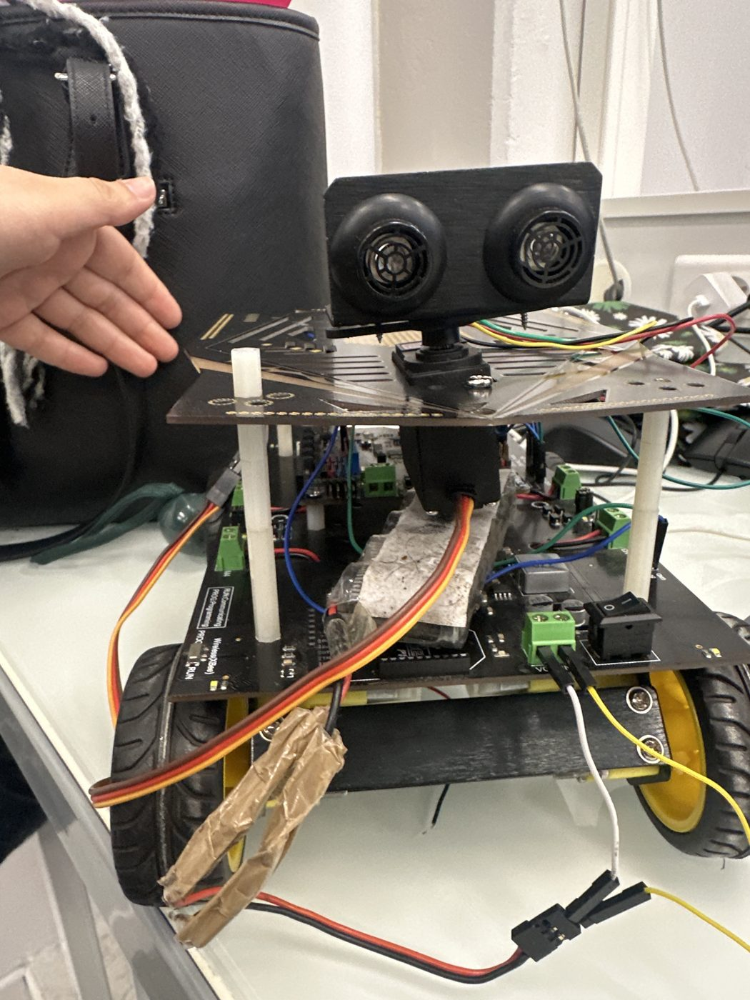

# Robot mobile autonome, Cherokey 4WD

Projet de L2 EEA à l'Université Côte d'Azur, réalisé en binôme (mai 2026). Le robot sort d'un labyrinthe avec un capteur à ultrasons, ou suit un objet avec une caméra HuskyLens. Ces deux modes sont deux firmwares séparés, qui ne tournent pas en même temps.



## Qui a fait quoi

| Partie | Responsable |
|---|---|
| Firmware de navigation (`firmware/navigation`) | Kenza Bezi |
| Firmware de suivi par caméra (`firmware/suivi-camera`) | Ma binôme |
| Fiche technique | Kenza Bezi |
| Présentation | Ma binôme |
| Assemblage, câblage, essais, débogage | Partagés |

## Matériel

- Châssis DFRobot Cherokey 4WD et carte Romeo BLE V1.0 (ATmega328P, driver moteur L298P intégré)
- Capteur à ultrasons URM37 V3.2 en mode PWM, monté sur un servomoteur 9g
- Caméra HuskyLens K210 en I2C

| Fonction | Broche |
|---|---|
| Vitesse moteurs M1 / M2 | D5 / D6 |
| Direction moteurs M1 / M2 | D4 / D7 |
| URM37 PWM / TRIG | D3 / D10 |
| Servomoteur | D9 |
| HuskyLens | SDA / SCL |

## Navigation

Le robot avance tant que rien n'est à moins de 25 cm devant lui. Sinon il s'arrête et mesure à 45°, 90° et 135°. Si ces trois directions semblent trop étroites, il mesure aussi à 0° et 180°. Il choisit alors le chemin le plus dégagé, ou fait demi-tour dans une impasse. Toutes les 800 ms, il vérifie aussi la distance aux murs sur les côtés et corrige sa trajectoire sous 15 cm.

Les mesures brutes étaient bruitées : `getStableDistance()` fait donc la moyenne de plusieurs mesures valides. Les essais ont aussi montré que le sens des moteurs était inversé par rapport à la documentation : `LOW` fait avancer et `HIGH` fait reculer sur notre exemplaire.

## Résultats des essais

| Essai | Résultat noté dans la fiche technique |
|---|---|
| Distance à 10, 20 et 30 cm d'un mur | Écart de 2 cm au plus jusqu'à 50 cm, instable au-delà de 80 cm |
| Filtre, sur 20 mesures à 25 cm | Écart-type réduit d'environ 8 cm à environ 1 cm |
| Arrêt devant un mur | Arrêt à 25 ± 3 cm |
| 10 passages de couloir avec un seul choix | 9 réussis, 1 échec dans un couloir très serré |
| Suivi par caméra | Couleur et visage stables, suivi de ligne instable et abandonné |

Le score de 9 sur 10 porte sur ces passages de couloir, pas sur 10 sorties complètes du labyrinthe.

## Limites connues

- Pendant le contrôle des murs, le robot continue d'avancer sans surveiller l'avant, car le code attend avec `delay()` et le servomoteur regarde sur le côté.
- L'absence d'écho renvoie 1000 cm, ce qui est interprété comme un chemin libre.
- Le test `duration >= 50000` ne peut jamais être vrai, car `pulseIn` s'arrête à 30 ms. `getDistance()` n'est pas utilisée.
- Les deux firmwares n'associent pas les moteurs M1 et M2 aux côtés gauche et droit de la même façon.
- L'algorithme prend des décisions locales et ne garantit pas de trouver la sortie.

## Compiler

Le projet utilise PlatformIO, à lancer dans le dossier de chaque firmware :

```
pio run
```

Le code est celui du projet, sans modification. Les fichiers `platformio.ini` ont été réécrits après la perte de l'ordinateur d'origine. Les deux firmwares compilent avec ces fichiers, mais cette version n'a pas été retestée sur le robot.
